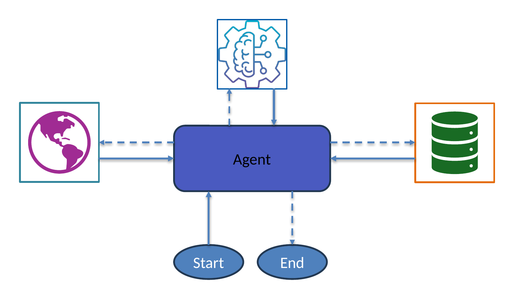
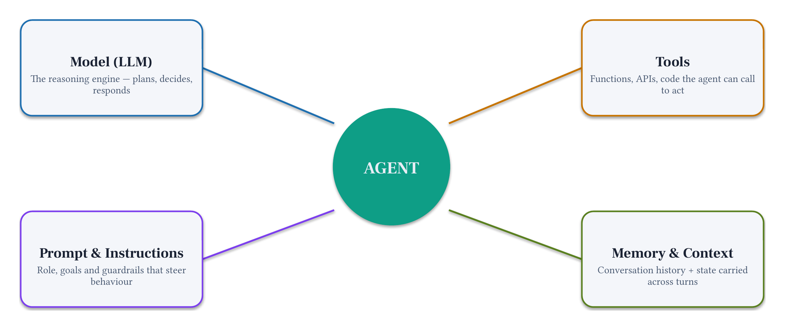

# Module 1: Foundations

Build a minimal Strands agent, run it, and inspect every step of the agentic loop.

## What you'll learn

- The 5 steps of the agentic loop: Input → Reasoning → Tool Selection → Tool Execution → Response
- How to define a tool with `@tool` and why the docstring matters
- How to create an `Agent` with tools and a system prompt
- How to inspect `agent.messages` to see every loop step
- Built-in observability: `result.metrics.get_summary()` (cycles, tokens, per-tool stats)

## Architecture

## Files

| File | Purpose |
|------|---------|
| `module-01.ipynb` | Step-by-step notebook: run an agent → define a tool → inspect the loop → metrics → multi-turn |
| `requirements.txt` | `strands-agents>=1.65.0` |

## Run

Open `module-01.ipynb` in VS Code or JupyterLab and run cells top to bottom.

## Prerequisites

- Python 3.10 or higher
- AWS credentials with Amazon Bedrock access in your workshop region

## Model

No `model=` is passed, so agents use the Strands default on Amazon Bedrock: Claude Sonnet 4.6 (`global.anthropic.claude-sonnet-4-6`). The notebook's model cell shows how to switch.

## Next

→ [Module 2: Single Agent](../02-single-agent/)
