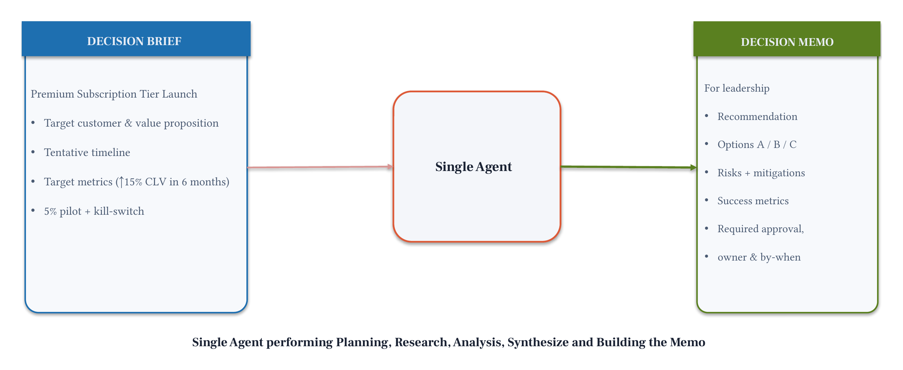
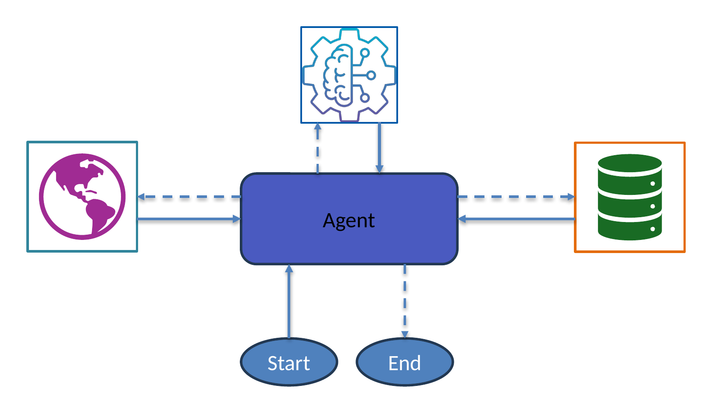

# Module 2: Single Agent

Build a Strategy Advisor agent with tools, run it, and inspect the agentic loop. Understand the single-agent ceiling before moving to multi-agent patterns.

## What you'll build

One agent with three mock business intelligence tools (company data, market benchmarks, competitor data). It answers focused questions about MarketNest, then gets the full decision brief from [`../shared/decision_brief.py`](../shared/decision_brief.py), the same brief Modules 3 and 4 use.

## Files

| File | Purpose |
|------|---------|
| `module-02.ipynb` | Step-by-step notebook: tools → agent → loop inspection → ceiling demo |
| `chat.py` | Interactive multi-turn chat with the notebook's Strategy Advisor agent (same prompt and tools) |
| `decision_brief_tools.py` | Three mock `@tool` functions + MarketNest mock data (also used by Modules 3 and 4) |
| `requirements.txt` | `strands-agents>=1.65.0` |

## Architecture



## How the Agentic Loop Works



## Key concepts

- `@tool` decorator: Python function the LLM can call; docstring is the routing logic
- `Agent(tools=[...], system_prompt=...)`: assembles model + tools + instructions
- `agent.messages`: full conversation history (user turns, LLM responses, tool calls, tool results)
- `result.metrics.get_summary()`: token usage, cycle count, per-tool stats
- The ceiling: why a single agent struggles with complex, multi-dimensional tasks

## Prerequisites

- Python 3.10 or higher

## Run

```bash
pip install -r requirements.txt
python chat.py
```

Or open `module-02.ipynb` in VS Code / JupyterLab and run cells top to bottom.

`chat.py` runs the notebook's Strategy Advisor (same system prompt, tools and model) and waits for you to type or paste a question or a brief. A multi-line text pasted at once (like `DECISION_BRIEF`) is sent as one message. The chat keeps ONE `Agent` for the whole session, so follow-up questions build on earlier answers; `context_manager="auto"` keeps that growing history within the model's context window. Type `quit` (or press Ctrl+C) to exit.

## Model options

No `model=` is passed, so the agent uses the Strands default on Amazon Bedrock: Claude Sonnet 4.6 (`global.anthropic.claude-sonnet-4-6`). To switch, pass `model=BedrockModel(model_id="...")`, for example:

- `us.anthropic.claude-haiku-4-5-20251001-v1:0`
- `amazon.nova-lite-v1:0` (bare ID: the Workshop Studio policy allows no Amazon inference profiles, and bare Nova Pro is on-demand only in us-east-1)

Use a model that is enabled in your account and Region.

## Next

→ [Module 3: Sequential Chain](../03-sequential-chain/)
