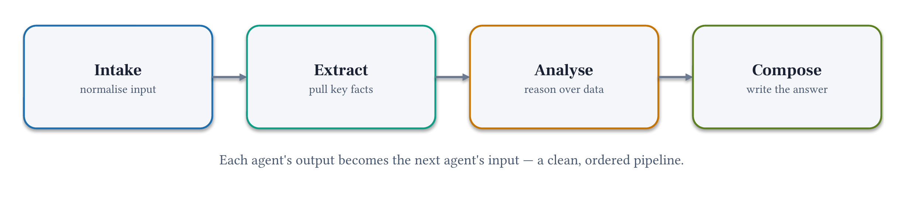

# Module 3: Sequential Chain

**Pattern 1.** Break the single-agent ceiling from Module 2: run the same decision brief through a fixed 3-stage pipeline where each agent has one focused job and passes its output to the next. The graph edges fix the order in code; in Module 4 an orchestrator agent chooses it instead.

**Strands primitive:** `GraphBuilder` (Graph)

## Architecture



## What you'll build

A 3-stage pipeline, Researcher → Analyst → Synthesizer, defined as a directed graph.
Each node receives the original brief plus the output of the node before it, so the
Synthesizer works from the Analyst's output, not the raw research.
Each agent has a narrow system prompt and sees only what it needs for its role.

## Files

| File | Purpose |
|------|---------|
| `module-03.ipynb` | Step-by-step notebook: prompts → GraphBuilder → run → inspect |
| `chat.py` | Run the same chain interactively, with conversation memory across turns |
| `requirements.txt` | `strands-agents>=1.65.0` |
| `production/` | Deploy specialists to AgentCore Runtime; coordinate via `chain.py` |

## Key concepts

- **GraphBuilder**: Strands primitive for multi-agent graphs; here a fixed sequence with an execution timeout
- **`add_node` / `add_edge`**: declare the graph structure; the engine enforces execution order
- **Output propagation**: each node gets the original task plus the outputs of the nodes with edges into it
- **`callback_handler=None`**: silent intermediate agents; display the final result explicitly
- **Focused context**: no single agent holds everything; per-node token usage (`node.result.accumulated_usage`) shows what each stage cost
- **Graph vs plain calls**: a short sequence also works as plain function calls (a workflow); the graph adds the timeout, `execution_order`, per-node results and room for parallel or conditional edges

## Strands GraphBuilder

```python
from strands import Agent
from strands.multiagent import GraphBuilder

researcher  = Agent(system_prompt=RESEARCHER_PROMPT,  callback_handler=None)
analyst     = Agent(system_prompt=ANALYST_PROMPT,     callback_handler=None)
synthesizer = Agent(system_prompt=SYNTHESIZER_PROMPT, callback_handler=None)

builder = GraphBuilder()
builder.add_node(researcher,  "researcher")
builder.add_node(analyst,     "analyst")
builder.add_node(synthesizer, "synthesizer")
builder.add_edge("researcher", "analyst")
builder.add_edge("analyst",    "synthesizer")
builder.set_execution_timeout(300)

result = builder.build()(DECISION_BRIEF)
print(result.results["synthesizer"].result)
```

See the [Strands GraphBuilder docs](https://strandsagents.com/docs/user-guide/sdk/multi-agent/graph/) and [multi-agent patterns](https://strandsagents.com/docs/user-guide/sdk/multi-agent/multi-agent-patterns/).

## Models: right-sized per stage

A chain lets you pick a model per stage, and this module does so on purpose:

| Stage | Model | Why |
|---|---|---|
| Researcher | Strands default, Claude Sonnet 4.6 (`global.anthropic.claude-sonnet-4-6`) | Choosing tools and filling in their arguments is the hardest step |
| Analyst, Synthesizer | Amazon Nova Pro (`us.` / `eu.` / `apac.amazon.nova-pro-v1:0`, from your region) | They only transform text they are handed, so a smaller, cheaper model is enough |

Nova Pro is called through its cross-region inference profile because the bare `amazon.nova-pro-v1:0` is rejected on-demand in most regions. In a region with no Nova Pro profile, those two stages fall back to the Sonnet default. The notebook, `chat.py` and `production/` use the same split.

**Pricing:**
- [Amazon Bedrock model pricing](https://aws.amazon.com/bedrock/pricing/)
- [Amazon Bedrock AgentCore pricing](https://aws.amazon.com/bedrock/agentcore/pricing/)

## Prerequisites

- Python 3.10 or higher
- Module 2. This module imports tools from `../02-single-agent/decision_brief_tools.py` and the brief from `../shared/decision_brief.py`

## Run

```bash
pip install -r requirements.txt
python chat.py
```

## Chat and conversation memory

`chat.py` runs the same graph as the notebook (same prompts, agents, edges and timeout) and waits for you to type or paste a brief. A multi-line brief pasted at once (like `DECISION_BRIEF` in the notebook) is sent as one message. Ask follow-ups in the same session; type `quit` (or press Ctrl+C) to exit.

Every turn builds the graph fresh, exactly like the notebook. The conversation is remembered with [Strands memory](https://strandsagents.com/docs/user-guide/sdk/memory/overview/):

- One in-memory [`TestMemoryStore`](https://strandsagents.com/docs/user-guide/sdk/memory/test-memory-store/) (`persist=False`, nothing is written to disk) stores only two entries per turn: what you said and the final answer (the synthesizer's memo). Nothing the agents say to each other is stored.
- Every agent gets its own `MemoryManager` over that store. [Context injection](https://strandsagents.com/docs/user-guide/sdk/memory/managing-memory/) adds the relevant entries to the agent's model input before each call. `search_tool_config=False` keeps each agent's tools the same as in the notebook.
- Inside a turn the agents still pass work to each other only through the graph edges.

`TestMemoryStore` uses keyword matching and is meant for prototyping. For production, use a managed store such as the [Bedrock Knowledge Base store](https://strandsagents.com/docs/user-guide/sdk/memory/bedrock-knowledge-base/).

## Next

→ [Module 4: Agent-as-Tool](../04-agent-as-tool/): let an orchestrator agent choose the order of work instead of graph edges.

Optional: [Parallel Fork-Join](../extra/04-parallel-fork-join/) runs the analysts in parallel with the same graph primitive.
