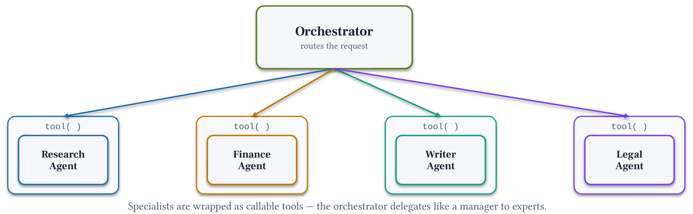

# Module 4: Agent-as-Tool

**Pattern 5.** Wrap specialized agents as callable tools so an LLM orchestrator can delegate like a manager to experts: routing decided by the model, not by graph edges as in Module 3.

## Architecture




## What you'll build

An LLM orchestrator for investment analysis on the same MarketNest decision brief as Module 2. It uses four specialist agents as tools: `research_agent`, `finance_agent`, `legal_agent` and `writer_agent`. Its prompt asks it to research first, then get the financial analysis and the legal review, and finally have the writer produce the investment memo. The model decides each call and its arguments; there is no Python routing code.

## Files

| File | Purpose |
|------|---------|
| `module-04.ipynb` | Step-by-step: prompts → wrap specialists → orchestrator → inspect calls → metrics |
| `chat.py` | Run the same orchestrator interactively; one orchestrator keeps the conversation |
| `requirements.txt` | `strands-agents>=1.65.0` |
| `production/` | Deploy the orchestrator and the four specialists to AgentCore Runtime (A2A) |

## Key concepts

- `@tool` wrapping `Agent`: full control over parameters; the docstring is the routing signal
- `Agent.as_tool(delegate=True)`: the writer's memo is the orchestrator's final answer, with no extra orchestrator model call to restate it
- `callback_handler=None`: silent specialists; the memo streams once through the orchestrator
- LLM routing: the orchestrator decides tool call order and arguments

## Three ways to use Agents as Tools

```python
# Option A: @tool function that calls an Agent (most control, multi-parameter)
@tool
def finance_agent(brief: str, research_context: str) -> str:
    """Analyze financial viability..."""
    worker = Agent(system_prompt=FINANCE_PROMPT, callback_handler=None)
    return str(worker(f"Investment brief:\n{brief}\n\nMarket research:\n{research_context}"))

# Option B: pass an Agent directly in tools[] (simplest; one natural-language input)
orchestrator = Agent(tools=[researcher, analyst, writer])

# Option C: .as_tool() (custom name/description, preserve_context, delegate)
orchestrator = Agent(tools=[writer.as_tool(description="...", delegate=True)])
```

This module uses Option A for research, finance and legal, and Option C with `delegate=True` for the writer. See the [Agents-as-Tools documentation](https://strandsagents.com/docs/user-guide/sdk/multi-agent/agents-as-tools/) (including Delegation) and [multi-agent patterns](https://strandsagents.com/docs/user-guide/sdk/multi-agent/multi-agent-patterns/).

**Pricing:**
- [Amazon Bedrock model pricing](https://aws.amazon.com/bedrock/pricing/?trk=87c4c426-cddf-4799-a299-273337552ad8&sc_channel=el)
- [Amazon Bedrock AgentCore pricing](https://aws.amazon.com/bedrock/agentcore/pricing/?trk=87c4c426-cddf-4799-a299-273337552ad8&sc_channel=el)

## Prerequisites

- Python 3.10 or higher
- Module 2 (Single Agent) and `shared/` must be in the same `samples/` folder. The notebook and chat.py load `decision_brief_tools.py` from `../02-single-agent/` and the notebook loads `DECISION_BRIEF` from `../shared/decision_brief.py`. Production deployments are self-contained (they bundle their own `mock_tools.py`).

## Run

```bash
pip install -r requirements.txt
python chat.py
```

`chat.py` uses the same prompts and `@tool` specialists as the notebook and waits for you to type or paste an investment brief. A multi-line brief pasted at once (like `INVESTMENT_BRIEF` in the notebook) is sent as one message. The chat keeps ONE orchestrator for the whole session, so it remembers the conversation: a follow-up about the memo is answered from its context, and it only calls the specialists again when the request needs new work. After each turn the chat lists the tool calls made in that turn. Type `quit` (or press Ctrl+C) to exit.

## Next

The core workshop ends here. Optional patterns and the capstone are in [`samples/extra/`](../extra/).
