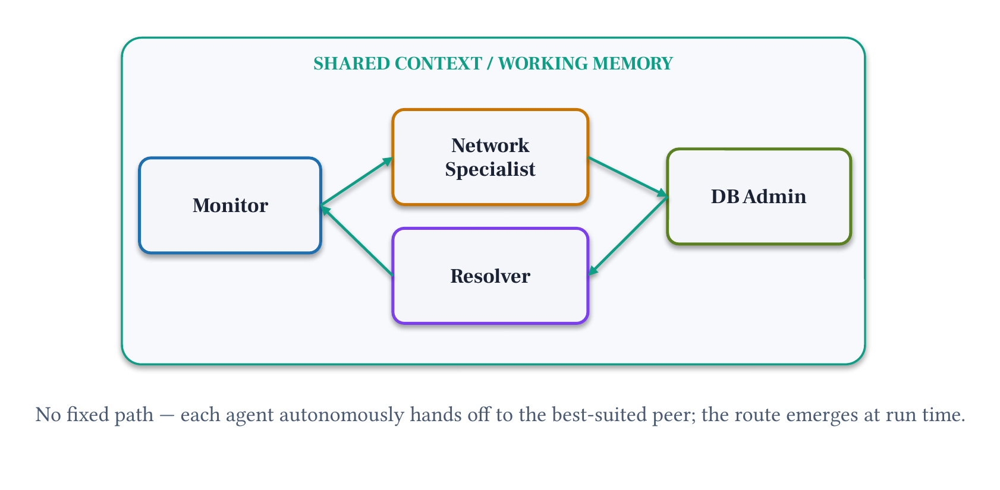

# Module 6: Dynamic Swarm

**Pattern 4.** Agents hand off autonomously — no fixed path, no orchestrator. The route through the team emerges at runtime based on what each agent decides to do next.

**Strands primitive:** `Swarm`

## Architecture



The path is not programmed — it emerges based on agent `description` fields and what each agent decides.

## What you'll build

A 4-agent Swarm for **IT incident response**. The route adapts to the incident:
- Network issue → `monitor → network_specialist → resolver`
- DB issue → `monitor → db_admin → resolver`
- Mixed → `monitor → network_specialist → db_admin → resolver`

No edges are defined. Each agent reads its peers' descriptions and decides who to involve next.

## Files

| File | Purpose |
|------|---------|
| `module-06.ipynb` | Step-by-step notebook: create agents → build swarm → run → inspect path |
| `chat.py` | Run the same swarm interactively, with conversation memory across turns |
| `requirements.txt` | `strands-agents>=1.52.0` |

## Agents

| Agent | Role | Routing signal |
|-------|------|----------------|
| `monitor` | Entry point — triages and classifies | Routes to network_specialist or db_admin |
| `network_specialist` | Network/infra root cause analysis | May route to db_admin or resolver |
| `db_admin` | Database root cause analysis | Routes to resolver |
| `resolver` | Synthesizes findings → resolution plan | Final agent |

## Key concepts

- `Swarm([agents], entry_point=agent)`: no routing code, agents decide
- `description` field: the routing signal; write it for the model, not for humans
- `handoff_to_agent`: automatically added to each agent by the SDK
- `result.node_history`: the path that emerged at runtime
- `result.results["agent_name"]`: output from a specific agent

## Strands Agents SDK

```python
from strands import Agent
from strands.multiagent import Swarm

monitor          = Agent(name="monitor",           description="Entry point...", system_prompt="...")
network_specialist = Agent(name="network_specialist", description="Network/infra...", system_prompt="...")
db_admin         = Agent(name="db_admin",          description="Database...", system_prompt="...")
resolver         = Agent(name="resolver",          description="Final resolution...", system_prompt="...")

swarm = Swarm(
    [monitor, network_specialist, db_admin, resolver],
    entry_point=monitor,
    max_handoffs=8,
    max_iterations=12,
)
result = swarm(incident_report)
# result.status, result.node_history, result.results["resolver"]
```

## Prerequisites

- Python 3.10 or higher

## Run

```bash
uv pip install -r requirements.txt
uv run python chat.py
```

## Chat and conversation memory

`chat.py` runs the same four-agent Swarm as the notebook (same prompts, descriptions and limits) and waits for you to type or paste an incident. A multi-line report pasted at once (like `INCIDENT_REPORT` in the notebook) is sent as one message. Ask follow-ups in the same session; type `quit` (or press Ctrl+C) to exit.

The chat prints the Swarm's final response: the output of the last agent, the one that ended without handing off. For a new incident that is the resolver, as in the notebook. A follow-up may be answered and ended by an earlier agent, such as the monitor.

Every turn builds the Swarm fresh, exactly like the notebook. The conversation is remembered with [Strands memory](https://strandsagents.com/docs/user-guide/sdk/memory/overview/):

- One in-memory [`TestMemoryStore`](https://strandsagents.com/docs/user-guide/sdk/memory/test-memory-store/) (`persist=False`, nothing is written to disk) stores only two entries per turn: what you said and the final response. Handoff messages and intermediate findings are not stored.
- Every agent gets its own `MemoryManager` over that store. [Context injection](https://strandsagents.com/docs/user-guide/sdk/memory/managing-memory/) adds the relevant entries to the agent's model input before each call. A Swarm resets each agent before it runs, but injection does not live in the agent's messages, so the memory still reaches it. `search_tool_config=False` keeps each agent's tools the same as in the notebook.
- Inside a turn the agents still collaborate only through the Swarm's handoffs and shared context.

`TestMemoryStore` uses keyword matching and is meant for prototyping. For production, use a managed store such as the [Bedrock Knowledge Base store](https://strandsagents.com/docs/user-guide/sdk/memory/bedrock-knowledge-base/).

## Next

→ [Module 7: Agent-as-Tool](../07-agent-as-tool/)
