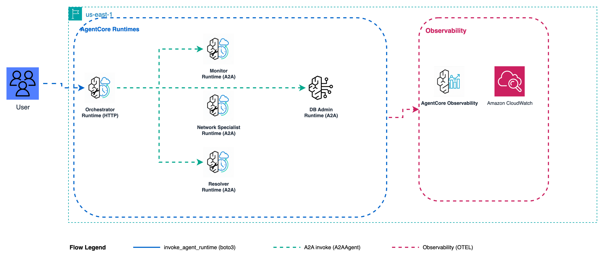

# Pattern 4: Dynamic Swarm - Production Deployment

Deploy the Pattern 4: Dynamic Swarm to Amazon Bedrock AgentCore Runtime using the A2A protocol.



**Pattern:** Monitor, Network Specialist, DB Admin, and Resolver agents hand off autonomously (IT incident response). The LLM Orchestrator decides routing at runtime.

**Strands primitive:** `Agent(tools=[])` with A2A specialists

> **Production note:** The Strands [`Swarm`](https://strandsagents.com/docs/user-guide/sdk/multi-agent/swarm/) class requires agents to be local objects in the same process — it injects a `handoff_to_agent` tool into each agent's `tool_registry`. In production, each specialist runs in a separate AgentCore Runtime container communicating via A2A protocol. [`A2AAgent`](https://strandsagents.com/docs/api/python/strands.agent.a2a_agent/index.md) wraps the remote endpoint as a client and does not expose `tool_registry`, so the Swarm class cannot be used directly across runtimes today.
>
> This deployment achieves equivalent semantics: the orchestrator LLM receives all four specialists as `@tool` functions backed by `A2AAgent` calls and decides routing autonomously at runtime — the same emergent behavior as a Swarm, implemented as Agent-as-Tool over A2A.

---

## Contents

- [Architecture](#architecture)
- [Files](#files)
- [Deploy](#deploy)
- [Invoke](#invoke)
- [Multi-turn chat](#multi-turn-chat)
- [Sample brief](#sample-brief)
- [Cleanup](#cleanup)
- [Observability](#observability)
- [References](#references)

---

## Architecture

**Specialists** run on port 9000 using the A2A protocol (`serve_a2a`).
**Orchestrator** receives calls via `invoke_agent_runtime` (HTTP),
then calls specialists via `A2AAgent` with SigV4 auth in isolated threads.

Per-session isolation: orchestrators keyed by `session_id` so different users
never share conversation history.

---

## Files

| File | Purpose |
|------|---------|
| `deploy.py` | Deploy 4 runtimes (specialists A2A + orchestrator HTTP) |
| `cleanup.py` | Delete all runtimes, IAM roles, S3 objects |
| `chat.py` | Interactive multi-turn chat |
| `invoke.py` | Single invocation. Pass orchestrator ARN as argument. |
| `orchestrator/main.py` | Orchestrator Runtime code |
| `specialists/monitor/main.py`, `network_specialist/`, `db_admin/`, `resolver/` | A2A specialist runtimes |

---

## Deploy

```bash
cd samples/06-*/production

python deploy.py                     # default prefix m6
python deploy.py --name-prefix m6ws  # custom prefix (max 8 chars)
python deploy.py --dry-run
```

Deploys `5` runtimes: monitor (A2A), network_specialist (A2A), db_admin (A2A), resolver (A2A), orchestrator (HTTP).

---

## Invoke

```bash
python invoke.py arn:aws:bedrock-agentcore:REGION:ACCOUNT:runtime/m6_orchestrator-XXXXX
```

---

## Multi-turn chat

```bash
# Interactive (multi-turn)
python chat.py \
  --actor-id workshop-user-01 \
  --runtime-arn $(cat .runtime_arn)

# Single prompt (non-interactive)
python chat.py \
  --actor-id workshop-user-01 \
  --runtime-arn $(cat .runtime_arn) \
  --prompt "CPU spike on db-prod-01. Disk I/O normal. Incident started 10 min ago."
```

In interactive mode, a multi-line brief pasted at once is sent as one message, and an empty line is ignored. Type `quit` (or press Ctrl+C) to exit.

---

## Sample brief

```
INCIDENT: E-Commerce Checkout Degradation. Checkout API latency 8200ms (baseline 450ms),
error rate 12% (HTTP 5xx on /api/checkout), DB connection pool 95% utilized (baseline 40%).
Started 15 minutes after deployment v2.4.1. Investigate root cause and produce a resolution plan.
```

First call: 3-5 min (cold start of 5 runtimes).
Subsequent calls: 2-4 min (warm containers; each turn runs Monitor → specialists → Resolver).

Type `quit` to exit `chat.py`.

---

## Cleanup

```bash
python cleanup.py --name-prefix m6          # delete everything
python cleanup.py --name-prefix m6 --dry-run
```

---

## Observability

AgentCore sends all telemetry to **Amazon CloudWatch**:

- **Logs:** `/aws/bedrock-agentcore/runtimes/<id>-DEFAULT` (one per runtime)
- **Traces:** CloudWatch Transaction Search (X-Ray settings > GenAI Observability)

---

## References

- [AgentCore Runtime docs](https://docs.aws.amazon.com/bedrock-agentcore/latest/devguide/runtime.html)
- [AgentCore A2A protocol](https://docs.aws.amazon.com/bedrock-agentcore/latest/devguide/runtime-a2a.html)
- [Strands Swarm](https://strandsagents.com/docs/user-guide/sdk/multi-agent/swarm/)
- [Strands A2A Agent-as-Tool](https://strandsagents.com/docs/user-guide/sdk/multi-agent/agent-to-agent/#as-a-tool)
- [bedrock-agentcore Python SDK](https://pypi.org/project/bedrock-agentcore/)
