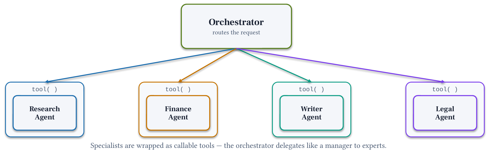

# Module 7: Agent-as-Tool

**Pattern 5.** Wrap specialized agents as callable tools so an LLM orchestrator can delegate like a manager to experts: routing decided by the model, not by Python code.

## Architecture




## What you'll build

An LLM orchestrator for investment analysis that uses four specialist agents as tools: `research_agent`, `finance_agent`, `legal_agent` and `writer_agent`. Its prompt asks it to research first, then get the financial analysis and the legal review, and finally have the writer produce the investment memo. The model decides each call and its arguments; there is no Python routing code.

## Files

| File | Purpose |
|------|---------|
| `module-07.ipynb` | Step-by-step: prompts → wrap tools → orchestrator → inspect calls → metrics |
| `chat.py` | Run the same orchestrator interactively; one orchestrator keeps the conversation |
| `requirements.txt` | `strands-agents>=1.52.0` |

## Key concepts

- `@tool` wrapping `Agent`: full control over parameters; docstring is the routing logic
- `callback_handler=None`: silent sub-agents; only the orchestrator and the writer stream their output
- LLM routing: the orchestrator decides tool call order and arguments
- Multi-parameter `@tool`: lets the orchestrator pass precise context per call

## Three ways to use Agents as Tools

```python
# Option A: @tool decorator (most control, multi-parameter): used in this module
@tool
def researcher_agent(topic: str) -> str:
    """Research market context..."""
    worker = Agent(tools=[...], system_prompt=..., callback_handler=None)
    return str(worker(topic))

# Option B: pass Agent directly in tools[] (simplest, single string input)
researcher = Agent(system_prompt=..., tools=[...])
orchestrator = Agent(tools=[researcher, analyst, writer])

# Option C: .as_tool() (custom name/description, optional preserve_context)
orchestrator = Agent(tools=[researcher.as_tool(name="...", description="...")])
```

## Strands Agents SDK

The Strands Agents SDK supports three ways to use agents as tools. This module uses the `@tool` decorator for full parameter control.
See [Agents-as-Tools documentation](https://strandsagents.com/docs/user-guide/sdk/multi-agent/agents-as-tools/index.md) and [multi-agent patterns](https://strandsagents.com/docs/user-guide/sdk/multi-agent/multi-agent-patterns/index.md).

```python
# Option 1: pass Agent directly (SDK auto-converts; single string input)
orchestrator = Agent(tools=[researcher, analyst, writer])

# Option 2: .as_tool() for custom name/description
orchestrator = Agent(tools=[researcher.as_tool(name="...", description="...")])

# Option 3: @tool decorator (full parameter control, used in this module)
@tool
def researcher_agent(topic: str) -> str:
    """Research market context..."""
    worker = Agent(tools=[...], system_prompt=..., callback_handler=None)
    return str(worker(topic))
```

**Pricing:**
- [Amazon Bedrock model pricing](https://aws.amazon.com/bedrock/pricing/?trk=87c4c426-cddf-4799-a299-273337552ad8&sc_channel=el)
- [Amazon Bedrock AgentCore pricing](https://aws.amazon.com/bedrock/agentcore/pricing/?trk=87c4c426-cddf-4799-a299-273337552ad8&sc_channel=el)

## Prerequisites

- Python 3.10 or higher
- Module 2 (Single Agent) must be in the same `samples/` folder. The notebooks and chat.py load `decision_brief_tools.py` from `../02-single-agent/` at runtime — it contains the MarketNest mock data and business intelligence tools used across all modules. Production deployments are self-contained (they bundle their own `mock_tools.py`).

## Run

```bash
uv pip install -r requirements.txt
uv run python chat.py
```

`chat.py` uses the same prompts and `@tool` specialists as the notebook and waits for you to type or paste an investment brief. A multi-line brief pasted at once (like `INVESTMENT_BRIEF` in the notebook) is sent as one message. The chat keeps ONE orchestrator for the whole session, so it remembers the conversation: a follow-up about the memo is answered from its context, and it only calls the specialists again when the request needs new work. After each turn the chat lists the tool calls made in that turn. Type `quit` (or press Ctrl+C) to exit.

## Next

→ [Module 8: Capstone: Strategy Recommendation Engine](../08-capstone/)
