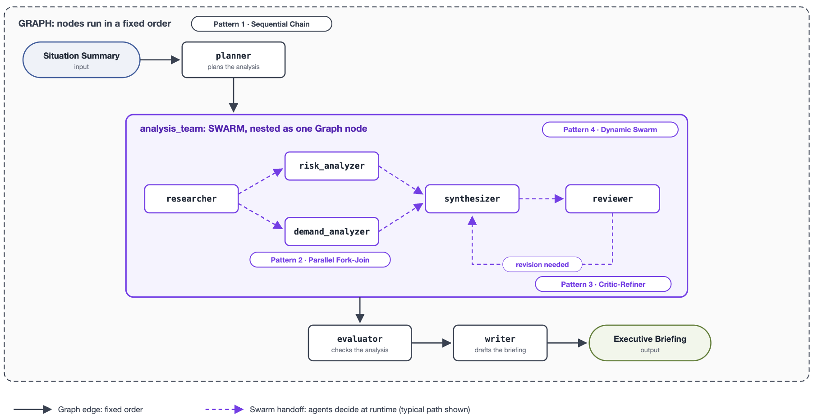

# Module 8: Capstone — Strategy Recommendation Engine

**"Situation summary in, executive strategy recommendation out."**
The multi-agent patterns from the earlier modules combined into one system.

**Strands primitives:** `GraphBuilder` · `Swarm` (nested as one graph node through a custom `MultiAgentBase` node)

## Architecture



## Patterns combined

| Pattern | Where it appears | Strands API |
|---------|------------------|-------------|
| **P1 Sequential Chain** | `planner → analysis_team → evaluator → writer` run in a fixed order | `GraphBuilder` edges |
| **P2 Parallel Fork-Join** | The researcher's findings feed two lenses, `risk_analyzer` and `demand_analyzer`, before the synthesizer joins them | Swarm handoffs (the notebook also shows it as a parallel `GraphBuilder`) |
| **P3 Critic-Refiner** | `reviewer` critiques the synthesizer's draft and hands it back until it is good enough | Swarm handoffs + `REVISION NEEDED` / `APPROVED` verdict line |
| **P4 Dynamic Swarm** | The analysis team decides who works next | `Swarm` nested as one graph node |

## Agents

| Agent | Role |
|-------|------|
| **planner** | Breaks the situation summary into tasks, missing info and decision criteria |
| **researcher** | Separates facts, assumptions, unknowns and risk triggers |
| **risk_analyzer** | Risk view per option, mitigations and kill triggers |
| **demand_analyzer** | Demand view per option against the success criteria |
| **synthesizer** | Sole author of the strategy recommendation |
| **reviewer** | Red-team critic; routes back to the synthesizer or researcher, or approves |
| **evaluator** | Picks the most complete recommendation and scores confidence (0–100) |
| **writer** | Produces the final executive strategy recommendation |

The agents reason only over the text they receive; they have no tools.

## Files

| File | Purpose |
|------|---------|
| `module-08.ipynb` | Step-by-step notebook: prompts → pattern demos (sequential, parallel, swarm) → full system → run → inspect hops |
| `chat.py` | Run the same system interactively, with conversation memory across turns |
| `requirements.txt` | `strands-agents>=1.52.0`, `matplotlib`, `networkx` (the last two are for the notebook diagrams) |
| `production/` | Deploy to Amazon Bedrock AgentCore Runtime (a different design, see below) |

## Run

```bash
pip install -r requirements.txt
python chat.py
```

## Chat and conversation memory

`chat.py` builds the same system as the notebook (same prompts, model, swarm limits and graph limits) and waits for you to type or paste a situation summary. A multi-line summary pasted at once (like `SITUATION_SUMMARY` in the notebook) is sent as one message. Each turn runs the full system and takes a few minutes. Ask follow-ups in the same session; type `quit` (or press Ctrl+C) to exit.

Every turn builds the system fresh, exactly like the notebook. The conversation is remembered with [Strands memory](https://strandsagents.com/docs/user-guide/sdk/memory/overview/):

- One in-memory [`TestMemoryStore`](https://strandsagents.com/docs/user-guide/sdk/memory/test-memory-store/) (`persist=False`, nothing is written to disk) stores only two entries per turn: what you said and the final answer (the writer's output). Handoffs, drafts and reviews are not stored.
- Every agent, including the swarm members, gets its own `MemoryManager` over that store. [Context injection](https://strandsagents.com/docs/user-guide/sdk/memory/managing-memory/) adds the relevant entries to the agent's model input before each call. `search_tool_config=False` keeps each agent's tools the same as in the notebook (none).
- Inside a turn the agents still pass work only through the graph edges and the swarm handoffs.

The writer's prompt always produces the full recommendation format, so a follow-up answer also comes back in that format. `TestMemoryStore` uses keyword matching and is meant for prototyping. For production, use a managed store such as the [Bedrock Knowledge Base store](https://strandsagents.com/docs/user-guide/sdk/memory/bedrock-knowledge-base/).

## What happens at runtime

1. `planner` writes the task decomposition, missing info and decision criteria.
2. `analysis_team` runs the Swarm: the researcher starts, the risk and demand analyzers add their lenses, the synthesizer drafts the recommendation, and the reviewer critiques it and hands it back or approves.
3. `evaluator` selects the most complete recommendation block and scores confidence.
4. `writer` produces the final executive strategy recommendation.

The Swarm stops at `max_handoffs=9` / `max_iterations=9`, or when it detects repetitive handoffs (for example, synthesizer ↔ reviewer ping-pong). In those cases its own status is `FAILED`. The custom `AnalysisSwarmNode` still reports `COMPLETED` and forwards the latest draft, so the evaluator always receives the team's work. The last cell of the notebook (and `chat.py`) prints the hops, the order, and that status.

## Deploy to production

The `production/` folder deploys an orchestrator with A2A specialists on AgentCore Runtime. It does not mirror the notebook's nested Swarm: Strands `A2AAgent` works as a graph node or a tool, but not inside a `Swarm`.

```bash
cd production/
cat README.md
```

## Prerequisites

- Python 3.10 or higher
- Modules 01–07
